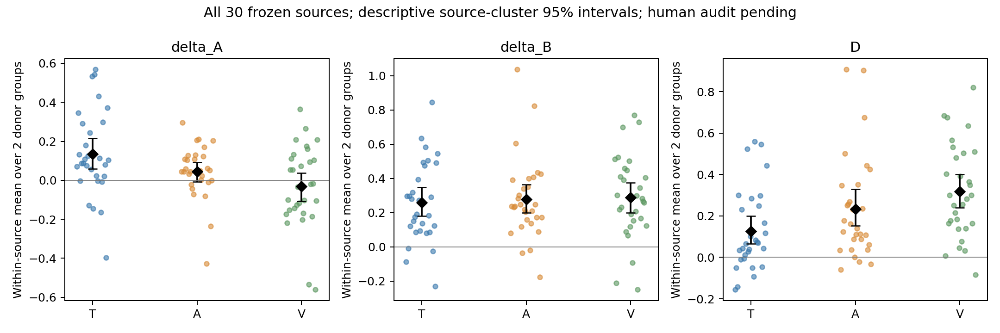

# RV-CED

逐输入通道匹配替换的情感分析预实验：固定其他通道，将目标通道替换为同极性或反极性供体，比较模型输出响应。

**状态：v3 真实 GPU pilot 已完成；跨片段组合存在内容与时间不同步，组合审核已停止。v4 自然冲突实验处于推理前盲审。** 本阶段没有训练或 LoRA。

## 当前审核：v4 原始同步片段

v3 冻结结果仍保留，但跨片段替换会造成字幕、语词、口型和时间不一致，因此不能支持纯模态因果结论。v4 不再拼接供体，只用每个原始片段自身同步的 T/A/V；先对严格自然冲突候选做两人独立盲审，再冻结最多 12 个 T 和 12 个 V 来源。完整说明见 [v4 审核与冻结](rvced_pilot/followup_analysis/v4_natural_conflict/README.md) 和 [协议问题记录](rvced_pilot/followup_analysis/protocol_issue_20261016/report.md)。

- **审核者离线包含原始视频，不放入公开仓库或 Release。** 请由项目组织者私下发送完整 ZIP；解压后先读 `先读我.txt`，再打开 `打开盲审.html`。
- 每人只填 35 个候选；每个候选依次做目标通道判断和原始同步质量检查。两人选择不同审核者编号，独立填写并导出各自 CSV。
- 页面不含模型输出、官方目标极性或私有映射。模型推理要等审核合并状态为 `READY_FOR_V4_INFERENCE` 后再运行；样本不足时不放宽阈值。

下面的 v2 下载仅用于保存旧 v3 审核材料；不要继续填写其中的“组合输入”部分。

## 队友填写：中文选项显示版v2

- **已下载过v1：[下载约50KB中文选项补丁](https://github.com/occ0620/RV-CED/releases/download/pilot-blind-review-ui-v2/reviewer_02_options_patch_v2.zip)**。先从旧页面导出CSV；补丁解压到v1目录的上一级，再打开新增的“打开盲审_中文选项.html”。原网页和媒体保留。
- **首次使用：[下载完整离线包v2（约1.43GB）](https://github.com/occ0620/RV-CED/releases/download/pilot-blind-review-ui-v2/reviewer_02_offline_v2.zip)**。完整解压，打开“打开盲审.html”，无需Python。
- [下载页及SHA256校验文件](https://github.com/occ0620/RV-CED/releases/tag/pilot-blind-review-ui-v2)；[完整字段说明](rvced_pilot/followup_analysis/reviewer/guide_labeled_v2.md)。

选项显示为“编码＝中文含义”，例如“1＝低信心”；导出仍保存原数字编码。强度原名称保持不变，统一说明0→4递增；空白、unknown、na分别表示未完成、无法判断、不适用。
已有CSV可在新页面“恢复旧评分CSV”导入，遇到与当前非空评分冲突时整体拒绝导入，不覆盖已有评分。原v1仍保留。
同一360个项目与657个媒体不变，原关系和高质量标准不变；两人独立填写，先通道后组合，最后私下提交reviewer_02.completed.csv。
代码克隆不携带媒体包。审核者请直接使用上述盲审包，不参考下方分析结果或另一位审核者评分。

## 实际运行

- 数据：CH-SIMS v2.0 有标签CSV，实际4,403条；4,268条通过全量媒体检查，test可用1,005条。
- 模型：Qwen2.5-Omni-7B，官方文本输出Thinker接口，权重固定 `ae9e1690543ffd5c0221dc27f79834d0294cba00`。
- 单卡A800 80GB；Python3.12.3、Torch2.3.0+cu121、Transformers4.53.3、qwen-omni-utils0.0.4、bf16。
- 同一批30源覆盖T/A/V，每源每模态2组供体，180/180三元组完整；390主输入、429单通道诊断、2代码映射诊断，共821评分任务，主运行失败0。
- 主运行180组非目标通道隔离全部通过，两次重复检查最大候选概率差0。源和供体不重叠，295个不同供体最多复用2次。

| 通道 | mean delta_A | mean delta_B | mean D [95%描述区间] |
|---|---:|---:|---|
| T | 0.135 | 0.260 | 0.125 [0.065,0.199] |
| A | 0.045 | 0.278 | 0.232 [0.153,0.330] |
| V | -0.032 | 0.287 | 0.319 [0.239,0.401] |

`s=p_positive-p_negative`，`d=-sign(y_target)`，`delta_A=d(s_A-s_0)`，`delta_B=d(s_B-s_0)`，`D=delta_B-delta_A`。
先源内平均两组供体，再跨源等权；2,000次按源聚类bootstrap。D不是净因果依赖，排序不是模态依赖排名。

相同30源上V−T的D差0.194，主要伴随A对照差异−0.166；B响应差只有0.027且区间宽。30源中27个标签极性全一致，冲突覆盖有限。
语音保留词义、字幕状态未知。审核和供体稳定性尚不足以验证协议，暂不启动第二模型或训练。

## 代码与说明

- [运行与部署](docs/RUNNING.md)
- [已有缓存复核、效应分解与统计单位](docs/RESULTS.md)
- [人工盲审、离线包与合并](docs/REVIEW.md)
- [相关工作核查](rvced_pilot/evidence/related_work.md)
- [可公开汇总表](rvced_pilot/followup_analysis/tables/)
- [验证与执行来源](docs/PROVENANCE.json)



## 快速检查

```bash
python -m pip install -r rvced_pilot/requirements-cpu.txt
python -m pytest rvced_pilot/tests -q -p no:tmpdir -p no:cacheprovider
python rvced_pilot/pilot.py --help
```

Git代码区发布代码、方法和汇总统计；本项目审核所需的完整盲化媒体包另在Releases提供。全量原始数据、模型权重、逐项标签/预测、私有审核映射和访问凭据保留在本地。
因此克隆仓库可运行单元测试，但无法仅凭仓库恢复原始逐项实验；运行需要自行准备数据/权重，复核原实验需要私有冻结产物。
不要用示例配置冒充已经执行的冻结配置。数据与模型的使用条件以各自官方来源为准；代码区没有附带全量原始数据或权重。
审核者使用专用盲审页面或上方完整离线包，不应查看分析报告。
