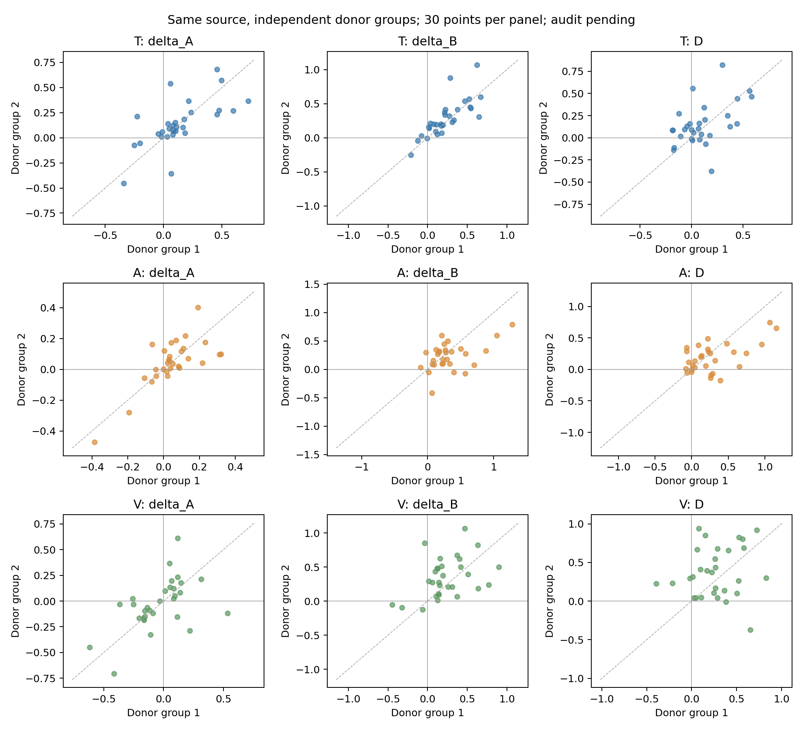
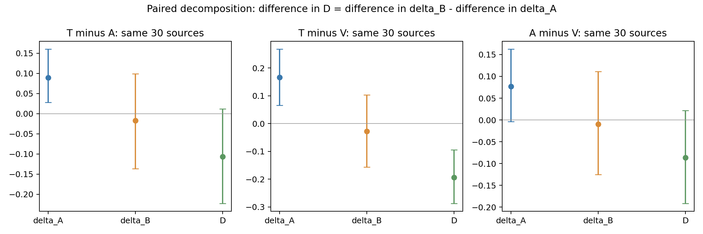

# RV-CED 已有结果复核、效应分解与盲审准备

**标签规则构造，关系审核待完成。没有新增模型推理、训练、消融、供体选择或阈值调整。**
全部新产物位于本目录；原 runs/main-a800-v3 文件不改写。新增中位数、A/B配对分解、逐源移除和新增审核字段为事后探索/准备，不替代原主指标。

## 复核与统计单位

已复核 30 个源、90 个源×模态单元、180个三元组、390个完整组合输入、821份预测/原子缓存（390主输入、429单通道、2代码映射）。
295个不同供体：230个使用一次、65个使用两次；源与供体不重叠，每单元两组供体不共享。全部冻结样本保留。
35个冻结文件逐一SHA256核验；模型身份/提示/预处理/评分的缓存键、原始logits的softmax、类别与s=p+−p−均重算一致。429种通道载荷及媒体文件逐项核验。
180组三元组的非目标通道内容哈希与官方处理器张量哈希均一致；原隔离结果通过。两次重复评分最大概率差0。实际失败0/180；没有静默删除、补零或不完整单元。
证据：[完整性记录](evidence/integrity.json)、[媒体哈希](evidence/media_hashes.csv)、[逐三元组隔离](tables/isolation_checks.csv)。Windows仅在内存映射远程媒体路径，未改冻结描述符。

d=−sign(y_target)，由冻结CSV目标模态标签决定，不由预测决定；源强度≥0.4。delta_A=d(s_A−s_0)，delta_B=d(s_B−s_0)，D=delta_B−delta_A。
主零容差为1e−6：正>tol，零为绝对值≤tol，负<−tol。字面 D>0 且 delta_B≤0 与按容差版本分别列出；没有把数值零当失败。原容差0、1e−6、1e−4、1e−3表见[零容差表](tables/zero_tolerance.csv)。

| 比例 | 原估计方法 | 分母/含义 |
|---|---|---|
| B正/零/负比例 | 每组三元组先判断方向，再源内平均两组指示值，再平均源 | 30个源的平均；本次等价60个三元组比例 |
| A类别稳定率 | 每组比较argmax类别是否等于原始类别，再源内及跨源平均 | 同上，不是先平均候选分数再argmax |
| 两组供体符号一致率 | 对每源比较两组delta_A、delta_B或D的含零符号 | 30次源级比较 |
| 源平均B偏移为正 | 先平均两组delta_B，再判断是否>tol | 新的事后指标，30源，不能替代原B正向比例 |

具体分子分母见[denominators.csv](tables/denominators.csv)。源平均指示值可为0、0.5或1，不是一个二元源判断。

## A、B、D分开分析

以下点估计先在源内平均两组供体，再在30源间计算均值或中位数。共同使用种子20261016、2,000次源聚类bootstrap；每次抽同一套source_id，保留其全部模态和两组供体。区间为描述性95%百分位区间，不覆盖任意供体选择的不确定性，也不校正多重比较。

| 通道 | 指标 | 原主均值 [95%区间] | 事后源级中位数 [95%区间] |
|---|---|---|---|
| T | delta_A | 0.135 [0.058, 0.216] | 0.096 [0.063, 0.180] |
| T | delta_B | 0.260 [0.181, 0.348] | 0.232 [0.131, 0.318] |
| T | D | 0.125 [0.065, 0.199] | 0.068 [0.031, 0.142] |
| A | delta_A | 0.045 [-0.007, 0.093] | 0.050 [0.023, 0.106] |
| A | delta_B | 0.278 [0.200, 0.365] | 0.237 [0.188, 0.321] |
| A | D | 0.232 [0.153, 0.330] | 0.151 [0.099, 0.255] |
| V | delta_A | -0.032 [-0.108, 0.037] | -0.027 [-0.122, 0.074] |
| V | delta_B | 0.287 [0.198, 0.375] | 0.275 [0.199, 0.398] |
| V | D | 0.319 [0.239, 0.401] | 0.292 [0.181, 0.402] |

[源级表](tables/source_effects.csv)、[逐三元组表](tables/triplet_effects.csv)、[完整区间表](tables/effect_summary.csv)、[分布分位数](tables/distribution_quantiles.csv)。分布主图每点为源内均值；合并60组三元组的中位数另列且明确标为探索性。


| 通道 | mean绝对A偏移 [95%区间] | A类别稳定 | B正/零/负（三元组分子/60） | 源平均B>0（分子/30，事后） |
|---|---|---|---|---|
| T | 0.203 [0.145, 0.261] | 47/60 | 53/60、0/60、7/60 | 26/30 |
| A | 0.108 [0.077, 0.144] | 57/60 | 54/60、0/60、6/60 | 27/30 |
| V | 0.181 [0.139, 0.226] | 53/60 | 53/60、0/60、7/60 | 27/30 |

两组供体稳定性同时报告符号和幅度，不能把高方向一致率等同于幅度稳定：

| 通道 | 指标 | 符号相同（分子/30） | 一致率95%区间 | mean两组绝对差 [95%区间] | Pearson（仅描述） |
|---|---|---|---|---|---|
| T | delta_A | 25/30 | [0.700, 0.933] | 0.137 [0.092, 0.188] | 0.666 |
| T | delta_B | 29/30 | [0.900, 1.000] | 0.119 [0.078, 0.169] | 0.779 |
| T | D | 17/30 | [0.400, 0.733] | 0.173 [0.119, 0.230] | 0.489 |
| A | delta_A | 25/30 | [0.667, 0.967] | 0.079 [0.056, 0.105] | 0.743 |
| A | delta_B | 24/30 | [0.633, 0.933] | 0.232 [0.168, 0.300] | 0.486 |
| A | D | 21/30 | [0.533, 0.867] | 0.230 [0.165, 0.301] | 0.547 |
| V | delta_A | 25/30 | [0.700, 0.967] | 0.160 [0.102, 0.225] | 0.525 |
| V | delta_B | 29/30 | [0.900, 1.000] | 0.263 [0.195, 0.338] | 0.419 |
| V | D | 25/30 | [0.700, 0.967] | 0.329 [0.248, 0.424] | 0.126 |

T的D符号仅17/30两组一致；V的D符号25/30一致，但幅度相关仅0.126、平均两组绝对差0.329。这些现象不足以称作“供体选择下仍稳定”。
[稳定性源表](tables/donor_stability_source.csv)、[汇总](tables/donor_stability_summary.csv)。



字面 D>0 且 delta_B≤0：9个三元组；源内先平均后为6个源×模态单元（5个不同源）。两种单位不可混用。
[9个三元组及全部分数](tables/D_positive_B_nonpositive_triplets.csv)、[6个源×模态单元列表](tables/D_positive_B_nonpositive_sources.csv)。D为正不代表B朝预期方向移动。

逐一移除一个源后仍只用剩余29源；这只是影响检查，不改变主样本或指标。均值范围：

| 通道 | 指标 | 全样本均值 | 移除后最小—最大 | 最大绝对变化 |
|---|---|---|---|---|
| T | delta_A | 0.135 | 0.120—0.153 | 0.018 |
| T | delta_B | 0.260 | 0.240—0.277 | 0.020 |
| T | D | 0.125 | 0.110—0.135 | 0.015 |
| A | delta_A | 0.045 | 0.037—0.062 | 0.016 |
| A | delta_B | 0.278 | 0.252—0.293 | 0.026 |
| A | D | 0.232 | 0.209—0.242 | 0.023 |
| V | delta_A | -0.032 | -0.045—-0.013 | 0.018 |
| V | delta_B | 0.287 | 0.271—0.306 | 0.019 |
| V | D | 0.319 | 0.302—0.333 | 0.017 |

本次三个D均值逐源移除后保持正值；这不处理供体复用、不验证关系，也不代表对多源联合删除稳健。[全部移除记录](tables/leave_one_source_out.csv)。

## 相同源的配对模态差

每个源先求模态差，再跨源平均；共同bootstrap抽样保留所有模态。每行方向为前者减后者。

| 对比 | delta_A差 [95%区间] | delta_B差 [95%区间] | D差 [95%区间] |
|---|---|---|---|
| T−A | 0.090 [0.028, 0.160] | -0.018 [-0.137, 0.099] | -0.107 [-0.223, 0.012] |
| T−V | 0.166 [0.066, 0.269] | -0.027 [-0.157, 0.103] | -0.194 [-0.288, -0.095] |
| A−V | 0.077 [-0.004, 0.163] | -0.010 [-0.125, 0.111] | -0.087 [-0.192, 0.022] |

V−T的D差0.194=delta_B差0.027−delta_A差(−0.166)；V−A为0.087=0.010−(−0.077)；A−T为0.107=0.018−(−0.090)。
点估计的D差主要伴随A对照差异，而不是明显更大的B响应。B差区间较宽且跨0，不能据此断言B效应相等。以上是代数分解，不是原因贡献或模态依赖排名。
[配对分解表](tables/paired_modality_decomposition.csv)。A/B分解是事后探索，原配对D仍单独保留。



## 源标签、预测和供体结构

30源中27个T/A/V/整体极性全一致；3个部分冲突，均有2个通道与整体一致；任何目标模态“唯一与整体一致”均为0。该抽样覆盖以一致情形为主，不能宣称已覆盖全部自然冲突情形。
原始预测负13、中性2、正15；候选内max(p)≥0.9仅4源，其余26源。这些p是三候选条件内分数，不是校准置信度。原整体标签准确率27/30，只是这30个源。
[30源标签/极性/强度/原始logits及分数](tables/source_labels_predictions.csv)、[90个目标模态结构](tables/source_modality_structure.csv)。
供体复用230×1、65×2，360次使用共295片段。时长/字符数、源相对比、A/B比、标签强度差逐对核验原阈值全部通过；不声称非情感因素已经充分平衡。
[供体匹配表](tables/donor_matching.csv)、[复用表](tables/donor_reuse.csv)。T匹配的是字符数；A匹配音轨时长；V匹配画面时长。
30源仅原视频ID有可靠字段；说话人、场景、字幕、语言、录音环境与语词冲突均未知。供体同样保留缺失标记。原视频ID不当作说话人身份，完整语音不是纯韵律输入。
[预设描述分层](tables/strata.csv)覆盖目标正负、原预测是否同向、max(p)≥0.9、目标唯一对齐、审核状态及字幕/语词冲突；新增标签结构分层标为事后。<10源的小格只列数量，不报告效应；空格或未知不能宣布发现缺口。

## 盲审的360项究竟是什么

固定抽样：每模态12个源×模态单元，共36单元（26个不同源）、72三元组。每单元为1个原始展示及两组各2个编辑展示，共5个内容对象；每个对象分别展示独立目标通道与完整组合：36×5×2=360行。原始对象在两组供体关系判定中复用一次评分。
每阶段均为原始36、同向72、反向72，这些条件只保存在私有分析映射中，不进入审核页面或评分表。
180行通道展示有177种不同内容（3个重复内容组、多出3次展示）；180行组合有170种不同内容（9个重复内容组、多出10次展示）。不能当成360个独立样本，也不能把去重后的347种分阶段展示当成独立证据。
[计数](tables/audit_composition.json)；详细重复映射只在 private/ 内，审核者不能查看。合并程序分别给展示加权与按内容去重加权的一致性/问题率，并保留重复展示内的一致性，不把重复当新增样本。
新审核界面沿用同一360个item_id，不暴露模型预测、答案类别、A/B身份、预期方向、unit_code或私有映射。使用严格白名单本地服务，只开放页面、盲化内容、指定空表、指南和带不透明ID的媒体；其他路径404。
两份[审核者1空表](reviewer/reviewer_01.blank.csv)、[审核者2空表](reviewer/reviewer_02.blank.csv)、[给审核者的字段指南](reviewer/guide.md)。NA仅表示不适用，不是预填评分。
第一步独立通道评极性/强度/信心/清晰度、完整语音词义可懂性与字幕可读性；第二步组合评六种问题。8帧无法充分验证同步；无原始参照时不能判断相对身份/场景变化就填unknown。技术隔离成功不替代这些判断。
原关系门槛：两人均判断源/同向供体同非零极性、反向供体反极性，三者两两强度差≤1，三者信心≥2。原高质量门槛还需两人对两个编辑均无处理错误、身份与场景变化标记分别已知且A/B对称。
**主高质量子集绝不要求被测模型单模态也判断正确。** 模型一致性只另列诊断。字幕、语词冲突、同步和清晰度按原门槛另报，未偷偷增加筛除条件。
新增字段、问题定义细化和完整性校验属于事后准备，已在未导入人工评分前固定于 [协议](evidence/review_protocol.fixed.json) 与SHA256文件。当前两份空表没有人工评分，关系通过率、一致性与高质量效应仍缺失。

## 可运行命令

从项目根运行，启动专用盲审页面：

```powershell
python rvced_pilot/followup_analysis/serve_review.py --port 8765
```

浏览器访问 http://127.0.0.1:8765/ 。本地媒体不公开上传；不要用通用http.server暴露整个项目。人工表填完后，使用新的输出目录：

```powershell
python rvced_pilot/followup_analysis/merge_reviews.py --reviewer-1 "C:/reviews/reviewer_01.completed.csv" --reviewer-2 "C:/reviews/reviewer_02.completed.csv" --out rvced_pilot/followup_analysis/review_imports/human-v1
```

只校验可加 --validate-only，并另选新目录。默认严格校验每人360个固定ID、阶段、全部适用字段与量表；不完整时保留原表和错误清单、退出2，不生成关系评分。两人身份必须不同。原文件路径可自行替换。
成功合并会保存两份独立原始CSV、SHA256、合并表、逐字段分歧、重复展示一致性、原/去重一致率及kappa、强度差、问题已知分母、72项关系通过与108项未评，以及原标准高质量子集。
只从已有预测缓存重算；先按各源通过的组平均再跨源等权，报告1组/2组源数。高质量子集最多覆盖72个预抽样三元组，不能推广为全180。后续裁定须另存版本，不覆盖独立评分。
重跑本轮缓存分析：

```powershell
python rvced_pilot/followup_analysis/run_analysis.py
python rvced_pilot/followup_analysis/write_report.py
```

不要在人工评分开始后重跑prepare_review或修改固定协议；如需修订须另建版本。

## 结论边界与下一步

**A．已有缓存支持：** 在这批标签规则构造的输入上，输出对通道替换有可测响应；同向A也明显移动。模态D差主要伴随A对照的差；供体符号与幅度稳定性并不一致。上述均为固定样本/固定供体条件下的模型行为描述，不是纯情绪因果效应。
**B．人工审核更新：** v3 的关系审核仍未完成；v4 自然冲突候选的双人步骤一已经完成。两人目标极性原始一致率为 19/35（54.3%，Cohen κ=0.295）；两人同时与官方目标方向一致的上限为 T 7/18、V 2/17，低于预定的每模态 10 条。v4 步骤二未形成完整的双人独立评分（审核者1完整34/35，审核者2完整1/35），因此不能报告双人质量问题率或高质量子集；但步骤二只能排除候选，不能逆转上述样本不足结论。审核闸门已固定为 `PAUSE_INFERENCE_INSUFFICIENT_REVIEWED_SOURCES`，详情见 [v4接收报告](v4_natural_conflict/review_intake/received_20261016_gate_v2/README.md)。
**C．需要第二模型或新实验：** 跨模型稳定性、任意供体选择下的推广、超出自然冲突评测的增量信息、纯韵律/纯视觉分离、未覆盖冲突结构。当前关系审核未完成，且供体幅度稳定性有限，因此不启动第二模型，也不提出训练建议。
仅当人工关系可靠、供体选择下仍稳定，并能提供超出自然冲突评测的信息，再讨论第二模型复核。若人工审核发现具体协议问题，仅提出一次针对该问题的小规模v4：预先固定数据质量/关系规则、种子与样本量，按人工问题和数据条件取样；不按已有D、预测方向或模型单通道正确率挑有利样本。
